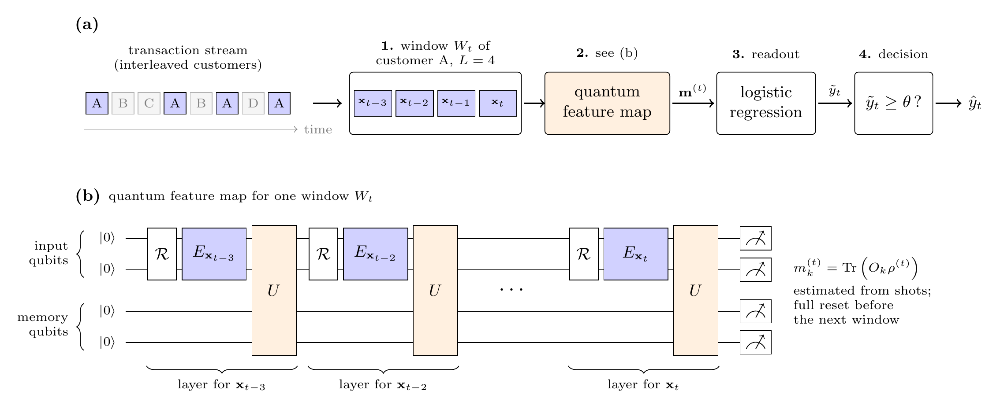

# Credit-card fraud detection with Quantum Reservoir Computing

This repository explores **Quantum Reservoir Computing (QRC)** for detecting fraudulent
credit-card transactions. For every transaction, the customer's last few transactions form a
window. A quantum reservoir processes the window, and a classical logistic readout is trained on
the measured observables. Classical controls (logistic regression on the raw window, an echo state
network and an LSTM) that run on exactly the same windows were also implemented.



*Our sliding-window QRC protocol. (a) For each transaction, the window of the customer's last L transactions is mapped by the
quantum feature map to a feature vector, which a logistic regression turns into a score, and a
threshold turns the score into a prediction. (b) Each transaction is one layer: reset of the input
qubits (optional, `--reset-inputs`), encoding, then evolution of the whole register. The memory
qubits are never reset within the window. [PDF](docs/figures/qrc_protocol.pdf)*

For more details on our implementation and a presentation of our main results, see our [final report](final-report.pdf).

---

## Quickstart

Requires **Python 3.11+** (`python --version`).

```bash
# 1. Clone
git clone https://github.com/zulee1711/cc_fraud_detection_using_QRC.git
cd cc_fraud_detection_using_QRC

# 2. Create and activate a virtual environment
python3 -m venv .venv
source .venv/bin/activate          # Windows: .venv\Scripts\activate

# 3. Install the project (editable, with all dependencies)
pip install -e .

# 4. Run your first experiment
python -m experiments.cli baseline --size small
python -m experiments.cli qrc      --size small
```

No dataset download is needed: by default the data is simulated on the fly. On a laptop, the
`small` preset takes a couple of seconds for `baseline` and under 10 seconds for `qrc`. Each run
prints its metrics and saves them under `results/runs/`, with one row per run appended to
`results/runs/summary.csv`.

The optional LSTM baseline also needs PyTorch: `pip install -e ".[classical]"`.

---

## Example tasks

Every experiment is `python -m experiments.cli <command> [options]`, with the command one of
`prepare`, `baseline`, `lstm`, `esn` or `qrc`. Add `--help` to any command for its options.

The examples below give the models only the raw transaction amount (`--feature-set 1`) over
windows of 10 transactions, so any memory of the customer's history has to come from the model.
Most take seconds on a laptop.

```bash
# Compare QRC with its classical controls on a mid-sized simulated dataset
python -m experiments.cli baseline --size medium --feature-set 1 --window-length 10
python -m experiments.cli esn      --size medium --feature-set 1 --window-length 10
python -m experiments.cli qrc      --size medium --feature-set 1 --window-length 10 --backend numpy

# A transverse-field Ising (TFIM) reservoir, measured in the X, Y and Z bases
python -m experiments.cli qrc --size medium --feature-set 1 --window-length 10 \
    --hamiltonian tfim --observables XYZ --backend numpy

# Finite measurement budget: noise of a ~1/precision² (here 10⁴) shot estimate on each expectation value
python -m experiments.cli qrc --size medium --feature-set 1 --window-length 10 \
    --hamiltonian tfim --observables XYZ --backend gaussian --simulator numpy --precision 0.01

# Pulse-level hardware noise with SpinPulse (a few minutes)
python -m experiments.cli qrc --size small --backend spinpulse --noise pink --t2 50000 --precision 0

# Many configurations in one go, data prepared once (one command per line in jobs.txt)
python -m experiments.sweep jobs.txt

# Hyperparameter search with Optuna
python -m experiments.tune --study-name depth --objectives depth --size small --n-trials 30
```

`--backend numpy` gives the same results as the default Aer backend and is much faster up to about
8 qubits (one input qubit per feature plus two memory qubits by default). Above that, keep the default backend.

**Further reading:**

- [docs/cli_reference.md](docs/cli_reference.md): every command and option, the metrics, backends,
  encodings, run outputs, reproducibility and sweeps.
- [docs/tuning.md](docs/tuning.md): the Optuna search (objectives, search space, outputs).
- [docs/data_pipeline.md](docs/data_pipeline.md): feature engineering, the feature catalog and the
  feature sets, preprocessing and windowing.
- [docs/experiments.md](docs/experiments.md): the experiment plan (arms A, B, C) and objectives.

---

## Data

By default, `--size small|medium|large` simulates 25 / 250 / 5000 customers over a year, with the
same fraud rate (~0.9%) and scenario mix. `small` is for quick tests; `medium` is the smallest size
with meaningful per-scenario metrics.

`large` with `--data-seed 0` is a team's shared dataset, which is also on
[SharePoint](https://tud365.sharepoint.com/:f:/r/sites/stud-JIPQuobly/Gedeelde%20documenten/Datasets/v1_simulated_dataset?d=w85e103b01b5d4ec189c07807a959dabf&csf=1&web=1&e=d6ftcI)
(team access only). Loading it is faster than regenerating it (about 7 minutes): download the three
split files into `data/` and pass `--data load`:

```
data/
├── transactions_train.pkl
├── transactions_validation.pkl
└── transactions_test.pkl
```

These files are produced by `qrc/datasets/split_dataset.py`. `data/` and `raw_data/` (unsplit
simulator output) are git-ignored.

---

## Using the package in your own code

After `pip install -e .`, `qrc` can be imported from anywhere:

```python
from qrc.encodings import AngleEncoding
from qrc.reservoirs import RandomCircuitReservoir
from qrc.observables import build_observables
from qrc.backends.estimator import EstimatorBackend
from qrc.protocol import QRCProtocol

encoder = AngleEncoding(num_qubits=4)
reservoir = RandomCircuitReservoir(num_input_qubits=4, num_mem_qubits=2, depth=2, rng=42)
observables = build_observables("Z+ZZ", reservoir.num_qubits)
protocol = QRCProtocol(encoder, reservoir, observables, EstimatorBackend())

features = protocol.run(X)   # X: (n_windows, window_length, n_features)
```

`qrc/pipeline.py` shows the complete wiring used by the CLI.

## Tests

```bash
pytest
```

CI runs the same suite on every push (`.github/workflows/tests.yml`).

---

## Project structure

```
cc_fraud_detection_using_QRC/
├── qrc/                     # the project package
│   ├── datasets/            # transaction simulation, train/validation/test split, file I/O
│   ├── features/            # fraud feature engineering
│   ├── analysis/            # exploration, feature scoring and selection, plots
│   ├── benchmarks/          # synthetic tasks: memory, parity, NARMA10
│   ├── backends/            # Qiskit Aer Estimator, NumPy (exact, small registers), SpinPulse (pulse-level noise)
│   ├── baselines/           # classical baselines: LSTM, echo state network, random feature maps
│   ├── pipeline.py          # data preparation, models and evaluation behind the CLI
│   ├── processing.py        # final model input: feature selection, imputation, scaling
│   ├── sequences.py         # 2D features → (n, window_length, features) per-customer windows
│   ├── encodings.py         # input encodings (AngleEncoding, ...)
│   ├── hamiltonians.py      # reservoir Hamiltonians
│   ├── trotter.py           # Trotterised time evolution
│   ├── reservoirs.py        # reservoir circuits
│   ├── observables.py       # measured observables
│   ├── protocol.py          # encode → evolve → measure loop
│   ├── readout.py           # classical readout layers
│   ├── decision.py          # decision threshold selection, Card Precision@K
│   ├── evaluation.py        # fraud categories and per-category average precision
│   └── logger.py
├── experiments/             # experiment scripts (not packaged)
│   ├── cli.py               # ← the experiment runner
│   ├── sweep.py             # many cli.py commands, data prepared once
│   ├── tune.py              # Optuna hyperparameter search over cli.py's qrc
│   └── fraud_2/             # one folder per study: the scripts that run it (writes results/fraud_2/)
├── docs/                    # CLI reference, tuning, data pipeline, experiment plan
├── tests/                   # pytest suite
├── thelab/                  # reference QRC implementation (git submodule)
├── data/                    # train/validation/test splits (git-ignored)
├── raw_data/                # unsplit simulator output (git-ignored)
└── results/                 # run outputs, sweeps and figures; results/<study>/ holds a study's run
                             # records, its plotting scripts and a README with the findings
```
